# BiÖğren

**Fiko ile birlikte öğren.** BiÖğren; ders materyallerini düzenlemeye, notlardan
özet kartları ve testler oluşturmaya, çalışma planı hazırlamaya ve öğrenme
ilerlemesini takip etmeye yönelik bir Flutter uygulamasıdır.

> Uygulama Android ve Chrome (web) hedeflerini destekler. Backend, FastAPI
> tabanlıdır. Ekran görüntüleri `assets/screenshots/` altında bulunan arayüz
> referanslarıdır.

## İçindekiler

- [Özellikler](#özellikler)
- [Ekran görüntüleri](#ekran-görüntüleri)
- [Mimari](#mimari)
- [Veri şeması](#veri-şeması)
- [API ve asenkron işler](#api-ve-asenkron-işler)
- [Geliştirme kurulumu](#geliştirme-kurulumu)
- [SWOT analizi](#swot-analizi)
- [Proje dizinleri](#proje-dizinleri)

## Özellikler

- E-posta ve şifre ile giriş, hesap oluşturma, e-posta doğrulama ve parola
  sıfırlama akışları.
- Ders kategorileri ve PDF/TXT not yükleme; indeksleme durumunu takip etme.
- Notlardan üretilen özet kartlarını çalışma ve kategoriye göre testleri çözme.
- Fiko ile kategori bağlamında yazılı sohbet; sohbet geçmişini sürdürme.
- Haftalık çalışma programı oluşturma, düzenleme ve tamamlanma durumunu izleme.
- Son testleri, kategori skorlarını ve çalışma süresini İlerleme ekranında
  görüntüleme.
- Fiko maskotu ve Türkçe, cesaretlendirici marka dili.
- Uzun süren yapay zekâ işlerinde kullanıcıya işlem devam ediyor bilgisini
  gösterme.

> “Fiko ile sesli konuş” ekranı şu an sesli deneyim arayüzü önizlemesidir;
> uygulamada gerçek konuşma tanıma veya sesli yanıt entegrasyonu bulunduğu
> anlamına gelmez.

## Ekran görüntüleri

Görseller `assets/screenshots/` klasöründen yüklenir:

| Giriş | Ana sayfa |
|---|---|
| 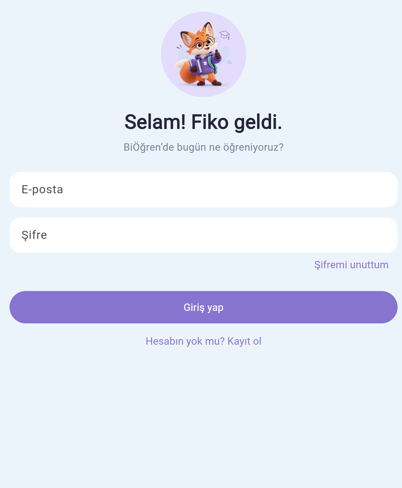 | 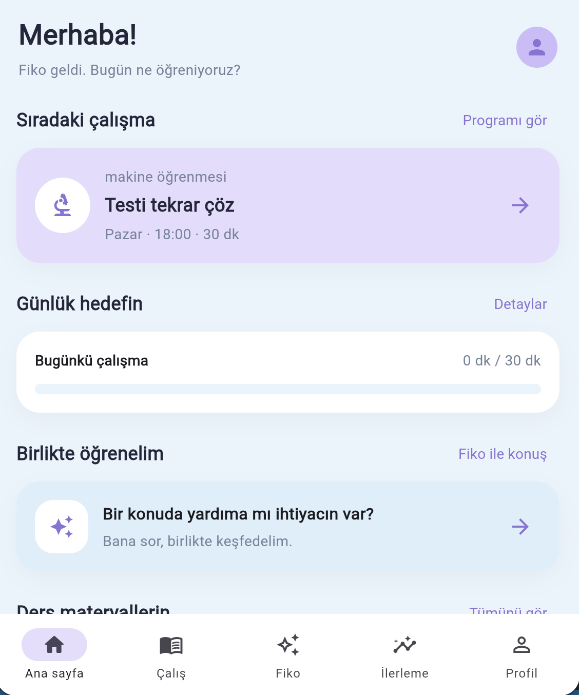 |

| Çalışma alanı | PDF kütüphanesi |
|---|---|
| 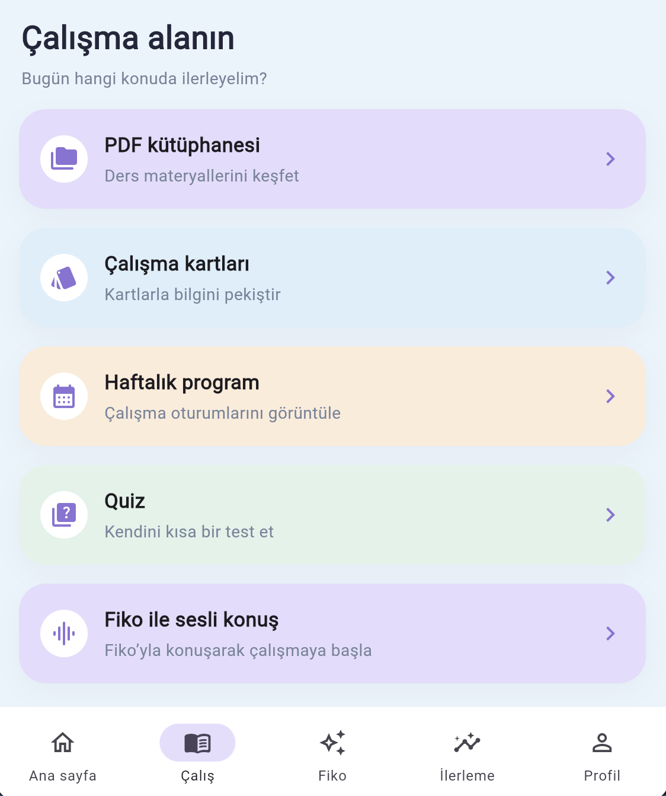 | 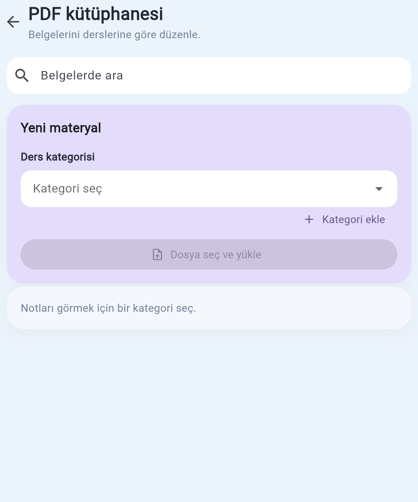 |

| Özet kartları | Test |
|---|---|
| 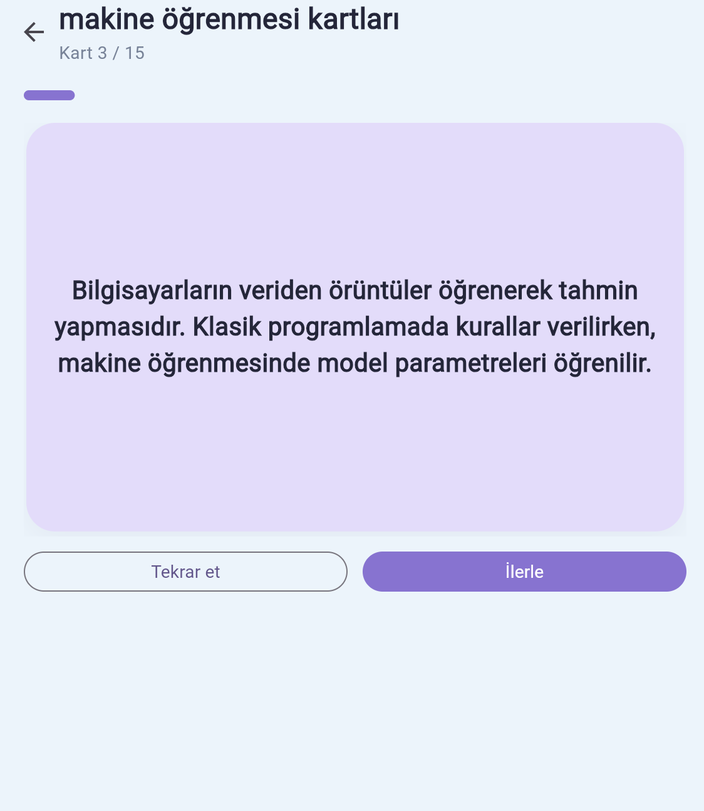 | 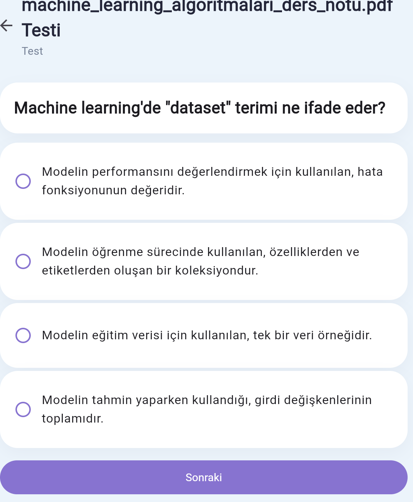 |

| Haftalık program | İlerleme |
|---|---|
| 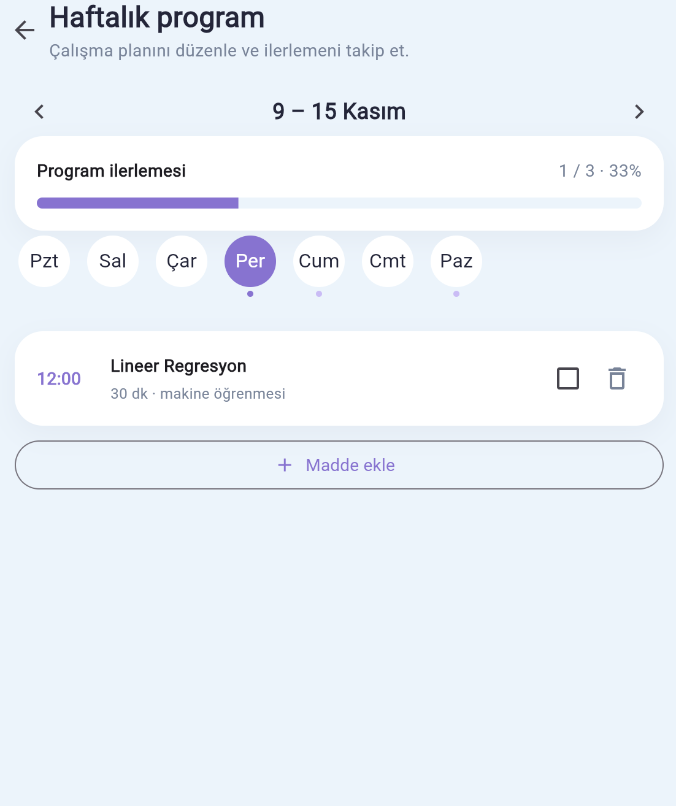 | 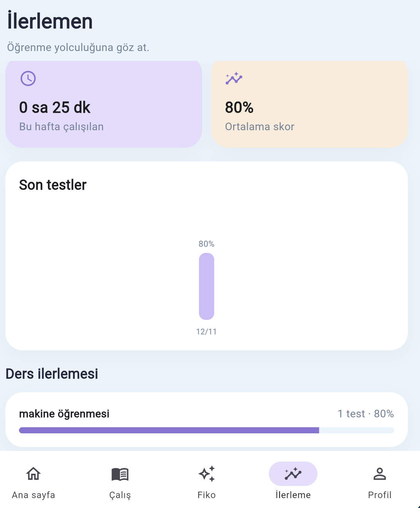 |

| Fiko ile sohbet |
|---|
| 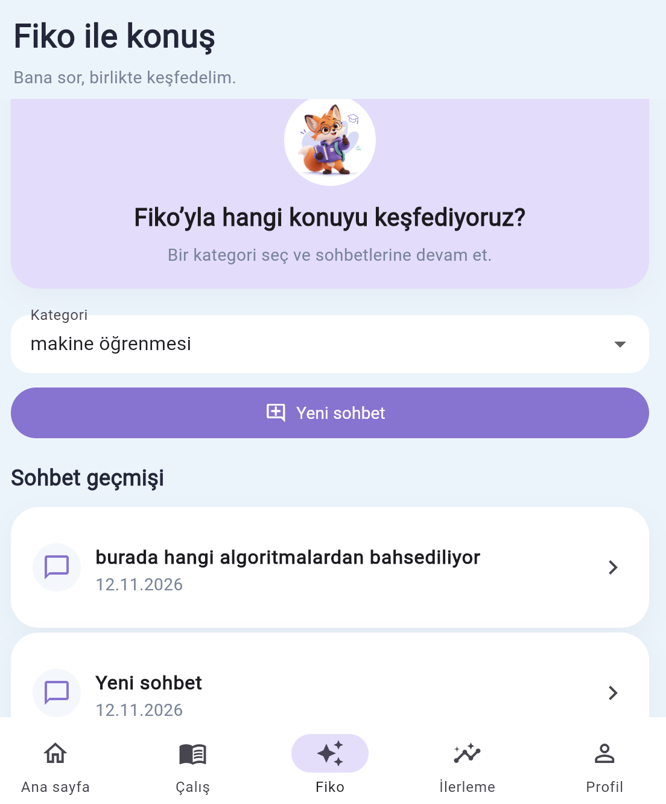 |

## Mimari

Flutter istemcisi ekranları ve kullanıcı etkileşimlerini yönetir. API istekleri
tek `ApiClient` üzerinden FastAPI servisine gider. Kimlik bilgileri güvenli
depolamada tutulur; yapay zekâ işlerinin sonucu kısa aralıklarla sorgulanır.

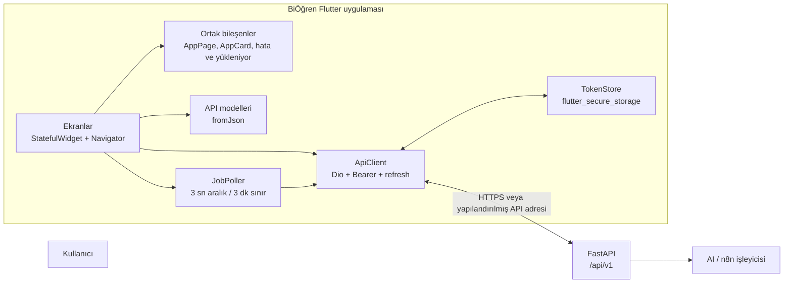

### Uygulama akışları

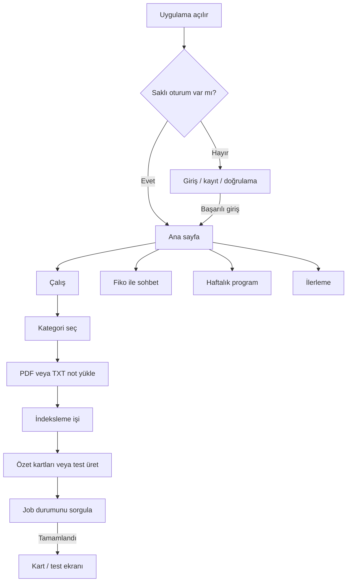

## Veri şeması

Aşağıdaki şema, istemcinin kullandığı temel kaynakları ve API ilişki
noktalarını özetler. Alanların resmi sözleşmesi backend OpenAPI dokümanıdır;
uygulama `lib/models/api_models.dart` içindeki `fromJson` modellerini kullanır.

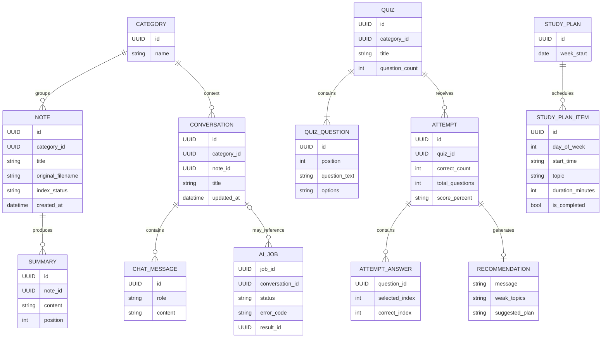

### Temel tip ve durumlar

| Alan | Uygulamadaki gösterim / kullanım |
|---|---|
| UUID kimlikleri | Dart tarafında `String` |
| Tarihler | API tarihleri `DateTime.parse` ile okunur; plan haftası `yyyy-MM-dd` gönderilir |
| Skor yüzdesi | Sayısal JSON değerleri veya sunucudan gelen sayısal metinler `double`'a çevrilir |
| `note.index_status` | `pending` / `running`: indeksleniyor, `indexed`: hazır, `failed`: yeniden deneme |
| `ai_job.status` | `pending` / `running`: bekle, `done`: sonucu kullan, `failed`: hata göster |
| Çalışma planı | Plan bir haftaya; çalışma maddeleri gün, saat, konu, süre ve tamamlanma bilgisine bağlıdır |

## API ve asenkron işler

Varsayılan API adresi:

```text
https://studyfriendbackend-production.up.railway.app/api/v1
```

`API_BASE_URL` derleme zamanı değişkeniyle farklı bir backend seçilebilir.
Uygulama API yollarını bu köke göre oluşturur.

| Alan | Kullanılan API yolları |
|---|---|
| Kimlik doğrulama | `/auth/register`, `/auth/login`, `/auth/refresh`, `/auth/logout`, `/auth/email/verify`, `/auth/email/resend-verification`, `/auth/password/forgot`, `/auth/password/reset` |
| Kategoriler ve notlar | `/categories`, `/notes`, `/notes/{id}`, `/notes/{id}/index` |
| Özet kartları | `/summaries`, `/notes/{id}/summaries`, `/notes/{id}/summaries/generate` |
| Testler ve denemeler | `/quizzes`, `/quizzes/{id}`, `/quizzes/{id}/attempts`, `/attempts/{id}/submit`, `/attempts/{id}/recommendation`, `/stats` |
| Sohbet | `/conversations`, `/conversations/{id}`, `/conversations/{id}/chat` |
| Program | `/study-plans`, `/study-plans/{id}`, `/study-plans/{id}/items` |
| Arka plan işleri | `/ai-jobs/{id}` |

Giriş sonrası isteklerde Bearer erişim token'ı kullanılır. `401` yanıtında
istemci refresh endpoint'ini dener ve özgün isteği en fazla bir kez tekrarlar.
Oturum yenilenemezse token'lar silinir. Token değerleri loglanmaz.

Not indeksleme, özet/test üretimi ve sohbet yanıtı arka plan işi olarak
çalışabilir. İstemci `GET /ai-jobs/{id}` sorgusunu 3 saniyede bir yapar; `done`
sonucunda ekrandaki veriyi yeniler, `failed` veya zaman aşımında kullanıcıyı
bilgilendirir.

## Geliştirme kurulumu

Gereksinimler:

- Flutter SDK ve Dart SDK (`pubspec.yaml` sürüm kısıtlarıyla uyumlu)
- Android Studio / Android SDK (Android hedefi için)
- Chrome (web hedefi için)
- Çalışan FastAPI backend'i veya erişilebilir API adresi

Bağımlılıkları yükleyip uygulamayı çalıştır:

```bash
flutter pub get
flutter run -d chrome
flutter run -d <android-device-id>
```

Yerel backend kullanımı:

```bash
flutter run -d chrome \
  --dart-define=API_BASE_URL=http://127.0.0.1:8000
```

Kontroller ve derlemeler:

```bash
flutter analyze
flutter test
flutter build web
flutter build apk --debug
```

Android emülatöründe `127.0.0.1` emülatörün kendisini ifade eder; bilgisayardaki
yerel backend'e bağlanırken uygun host adresini kullanın. Web tarayıcısında
yerel backend kullanılacaksa backend CORS ayarları da tarayıcı origin'ine izin
vermelidir.

## SWOT analizi

| Güçlü yönler (Strengths) | Zayıf yönler (Weaknesses) |
|---|---|
| Not, kart, test, sohbet ve haftalık planı tek öğrenme akışında birleştirir. | Özet/test/sohbet gibi AI özellikleri backend ve harici AI işleyicisinin erişilebilirliğine bağlıdır. |
| Android ve Chrome'da çalışan, ortak Flutter arayüzü. | Sesli asistan şu an arayüz önizlemesi; gerçek sesli etkileşim henüz uygulamada yok. |
| Türkçe, teşvik edici Fiko marka dili ve görsel maskot. | İlerleme ekranının veri kapsamı backend'in istatistik sözleşmesiyle sınırlıdır. |
| Token saklama, refresh ve AI işi polling altyapısı merkezi olarak yönetilir. | Çevrimdışı çalışma ve API verilerinin yerel önbelleği kapsam dahilinde değildir. |

| Fırsatlar (Opportunities) | Tehditler (Threats) |
|---|---|
| Gerçek sesli sohbet ve erişilebilirlik özellikleriyle yeni öğrenme biçimleri eklenebilir. | AI servisinde kesinti, gecikme veya kota aşımı üretim akışlarını etkileyebilir. |
| Öğrenme geçmişiyle daha kişisel öneriler ve çalışma planları geliştirilebilir. | Kullanıcı notları ve sohbet içeriği hassas olabilir; veri erişimi, saklama ve silme politikaları backend ile net tutulmalıdır. |
| Eğitim kurumları ve ders materyali iş akışlarıyla entegrasyon sağlanabilir. | Web istemcisinde API güvenliği, CORS ve kimlik doğrulama yapılandırması yanlışsa kullanım kesilebilir. |
| Fiko karakteri ve tutarlı marka dili ürün bağlılığını artırabilir. | Backend API sözleşmesi değişirse istemci modelleri ve ekranlar eş zamanlı güncellenmelidir. |

## Proje dizinleri

```text
lib/
  core/       API istemcisi, token saklama, config, polling, tema
  models/     API yanıtları için Dart modelleri
  screens/    Uygulama ekranları
  widgets/    Tekrar kullanılan ekran ve arayüz bileşenleri
assets/
  screenshots/  README'de kullanılan ekran görüntüleri
test/         Model ve widget testleri
```
